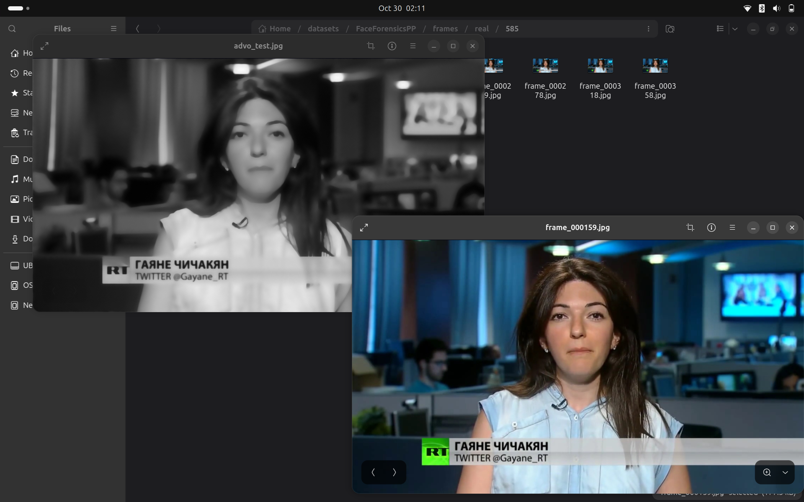

# Implementation and Evaluation of a Deepfake Detection Approach Using ADVO, U-Net and Hybrid GCN

## Abstract

Deepfake technology has created significant challenges for digital forensics and cybersecurity. This project implements and evaluates an approach proposed in the research paper *A Deep Fake Detection Approach for Cyber Security Threat Based on Deep Learning and Diffusion-Osmosis Model* (2025).

The implementation combines Anisotropic Diffusion-Variational Osmosis (ADVO) filtering, U-Net-based edge detection, and a Hybrid Graph Convolutional Network (GCN) for classification. The FaceForensics++ dataset was used, consisting of 809 real videos and 317 manipulated videos. Ten frames were extracted from each video, producing 11,260 images.

The preprocessing and model execution stages were completed. However, the classification models achieved 71.35% test accuracy while predicting every test sample as real. Consequently, fake-class recall was zero. The results highlight implementation challenges involving incomplete architectural specifications, pseudo-label generation, and inconsistencies between training and testing inputs.

**Keywords:** Deepfake detection, cybersecurity, ADVO, U-Net, Graph Convolutional Network, FaceForensics++.

## 1. Introduction

Advancements in artificial intelligence have made it possible to generate and manipulate highly realistic images and videos. These manipulated media, commonly known as deepfakes, can be used for misinformation, identity theft, financial deception, and other cybersecurity threats.

Deepfake detection is therefore an important research area in digital forensics and cybersecurity.

This project is based on the research paper *A Deep Fake Detection Approach for Cyber Security Threat Based on Deep Learning and Diffusion-Osmosis Model*, published in the *Egyptian Informatics Journal* in 2025.

The paper proposes a combined approach consisting of:

1. Hybrid Anisotropic Diffusion-Variational Osmosis for image filtering.
2. U-Net for image segmentation and edge detection.
3. Hybrid Graph Convolutional Network with separable convolution for classification.

The original paper reports an accuracy of 99.71% on its experimental dataset. The objective of this project was to implement the proposed components using an available public dataset and evaluate their performance.

### 1.1 Objectives

The main objectives were:

- To study and implement the ADVO image-filtering approach.
- To implement U-Net for edge detection.
- To develop a Hybrid GCN-based classification model.
- To integrate the implemented components into a detection pipeline.
- To evaluate the models using standard classification metrics.
- To identify implementation challenges and limitations.

## 2. Dataset and Data Preparation

### 2.1 Dataset Description

The FaceForensics++ dataset was used for implementation and evaluation.

The selected data consisted of original YouTube videos and manipulated videos from the Deepfakes category, using the C23 compression setting.

The dataset contained:

| Category | Number of videos |
|---|---:|
| Real | 809 |
| Fake | 317 |
| **Total** | **1,126** |

### 2.2 Frame Extraction

Since the implemented models process images, ten frames were extracted from each video.

This produced the following dataset:

| Category | Videos | Extracted frames |
|---|---:|---:|
| Real | 809 | 8,090 |
| Fake | 317 | 3,170 |
| **Total** | **1,126** | **11,260** |

The extracted frames were stored separately in real and fake directories.

### 2.3 Dataset Splitting

The dataset was divided into training, validation, and testing sets at the video level. This ensured that frames from the same video were not distributed across different subsets.

| Dataset split | Videos | Frames |
|---|---:|---:|
| Training | 787 | 7,870 |
| Validation | 168 | 1,680 |
| Testing | 171 | 1,710 |
| **Total** | **1,126** | **11,260** |

The class labels were assigned as follows:

- Real: 0
- Fake: 1

### 2.4 ADVO Preprocessing

The extracted frames were processed using the implemented ADVO filtering method. The processed images were stored separately, preserving the original dataset.

All 11,260 images were processed successfully, with no reported failures. The original video-level splits were retained.

### 2.5 Input Preparation

For model training, images were converted into grayscale and resized to 224 × 224 pixels. They were then converted into PyTorch tensors and supplied to the models through DataLoaders.

The dataset was imbalanced: approximately 71.9% of the frames were real and 28.1% were fake. Class-weighted training experiments were therefore conducted.

## 3. Implementation Methodology

The implementation consisted of three main components: ADVO filtering, U-Net-based edge detection, and Hybrid GCN-based classification.

### 3.1 ADVO Image Filtering

The first stage applied Anisotropic Diffusion-Variational Osmosis filtering to the extracted frames.

The purpose of this stage was to reduce unwanted image variations while preserving important structural information, such as edges and boundaries.

The implementation involved:

1. Converting input images into grayscale.
2. Calculating image gradients.
3. Computing diffusion coefficients using gradient information.
4. Applying diffusion and curvature-based filtering.
5. Iteratively updating pixel values to generate filtered images.

The implementation followed the equations available in the research paper. However, some parameters and numerical implementation details were not sufficiently specified. Experimental values were therefore selected for parameters such as the diffusion coefficient, time step, and number of iterations.

The filtering process was applied to all 11,260 images, and all were processed successfully.

### 3.2 U-Net for Edge Detection

The second component used a U-Net architecture for image segmentation and edge detection.

A U-Net model was implemented using an encoder-decoder structure with skip connections. The encoder extracts image features, while the decoder reconstructs spatial information to generate an output map.

The implemented architecture contained:

- Four encoder stages.
- A bottleneck layer.
- Four decoder stages.
- Skip connections between corresponding encoder and decoder stages.
- A final output layer generating an edge probability map.

The research paper does not provide sufficient details about the exact U-Net architecture or the pixel-level annotations required for training. Therefore, Canny edge detection was used to generate pseudo-labels.

The U-Net was trained for five epochs using these generated edge maps.

The model learned to reproduce Canny-style edge maps. These outputs should not be interpreted as verified deepfake manipulation masks.

### 3.3 Hybrid Graph Convolutional Network

The third component was a Hybrid Graph Convolutional Network for classification.

According to the research paper, this architecture combines convolutional feature extraction, separable convolution, and graph-based feature learning.

The implemented model contained two main branches.

**CNN branch:**

- Extracts spatial features from the input image.
- Uses convolutional and depthwise separable convolution operations.
- Produces a compact feature representation.

**Graph branch:**

- Converts spatial feature representations into graph nodes.
- Applies graph convolution operations to learn relationships between nodes.
- Uses pooling to obtain a compact graph representation.

The outputs of both branches are combined and passed to a classifier that predicts whether the input is real or fake.

The paper does not fully specify the graph construction, adjacency matrix, and complete internal architecture. Therefore, a simplified Hybrid GCN was implemented using a chain-based adjacency structure and two graph convolution layers.

This implementation is an approximation of the proposed architecture.

### 3.4 Model Integration

The intended detection pipeline consisted of the following stages:

1. Input image processing using ADVO filtering.
2. Edge-map generation using U-Net.
3. Feature extraction and classification using Hybrid GCN.
4. Prediction of real or fake classes.

The components were tested to verify that they could execute and exchange data.

However, the Hybrid GCN was trained using ADVO-filtered images, whereas the integrated evaluation supplied U-Net-generated edge maps. This created a mismatch between the classifier's training and testing inputs, which is an important limitation of the current implementation.

## 4. Model Training and Experimental Results

### 4.1 Training Configuration

The models were trained using PyTorch on a CPU-based system because a GPU was unavailable.

| Parameter | Setting |
|---|---|
| Framework | PyTorch |
| Hardware | CPU |
| Input image size | 224 × 224 |
| Batch size | 8 (4 for U-Net) |
| Optimizer | Adam |
| Learning rate | 0.001 |
| Classification training | 5 epochs |
| U-Net training | 5 epochs |
| U-Net loss function | Binary Cross-Entropy with Logits |
| Classification loss | Cross-Entropy Loss |

Class weights were also introduced during classification experiments to address the imbalance between real and fake samples.

### 4.2 U-Net Training Results

The U-Net was trained using Canny-generated edge maps as pseudo-labels.

The training loss decreased from 0.1311 to 0.0718, while the validation loss decreased from 0.0936 to 0.0806 over five epochs.

The model successfully learned to generate edge probability maps resembling its training targets.

These results indicate that the U-Net learned the pseudo-label generation task. They do not establish that it can accurately identify manipulated regions.

### 4.3 Classification Results

The Hybrid GCN and a simpler CNN model were evaluated using the test dataset containing 1,710 frames.

The results were:

| Metric | Hybrid GCN | Simple CNN |
|---|---:|---:|
| Accuracy | 71.35% | 71.35% |
| Real-class recall | 100% | 100% |
| Fake-class recall | 0% | 0% |
| Fake-class F1-score | 0% | 0% |

Both models classified every test sample as real.

The confusion matrix for both classifiers was:

| Actual / Predicted | Real | Fake |
|---|---:|---:|
| Real | 1,220 | 0 |
| Fake | 490 | 0 |

Although the models achieved approximately 71.35% accuracy, they failed to detect any fake samples.

### 4.4 Class-Weighted Training

To address class imbalance, additional experiments were conducted using class-weighted loss.

The approximate class weights were:

- Real: 0.70
- Fake: 1.79

However, this adjustment did not improve fake-class detection. The models continued to predict all test samples as real.

### 4.5 Video-Level Evaluation

An additional evaluation was performed at the video level.

Predictions from frames belonging to the same test video were averaged to obtain a video-level prediction.

The evaluation covered 171 test videos:

| Category | Number of videos |
|---|---:|
| Real | 122 |
| Fake | 49 |
| **Total** | **171** |

The video-level accuracy was also 71.35%. The model continued to classify all videos as real.

### 4.6 Experimental Observations

The experiments demonstrate that completing an implementation pipeline does not necessarily mean that the proposed method has been successfully reproduced.

The main limitation was the failure of the classification models to distinguish fake samples from real samples.

The class-weighted experiments did not resolve this issue. Furthermore, the implemented Hybrid GCN was an approximation of the architecture described in the paper.

The integrated evaluation also involved a difference between the inputs used during classifier training and those supplied during integrated testing.

Therefore, these results should be considered preliminary implementation results rather than a successful reproduction of the paper's reported performance.

## 5. Discussion

The implementation covered the major components of the proposed deepfake detection approach: ADVO image filtering, U-Net-based edge detection, and Hybrid GCN-based classification.

The preprocessing and model execution stages were completed successfully. However, the classification experiments did not achieve satisfactory deepfake detection performance.

Both classification models achieved approximately 71.35% accuracy but classified every test sample as real. This demonstrates why accuracy alone is insufficient for evaluating a classifier on an imbalanced dataset.

The zero recall for the fake class indicates that the models failed to identify manipulated samples.

The experiments also highlighted the importance of consistency between model training and testing inputs. The integrated pipeline supplied U-Net-generated edge maps to a classifier trained on ADVO-filtered images. This mismatch may have contributed to the poor classification performance.

## 6. Limitations

The implementation had the following limitations:

1. **Incomplete paper specifications:** The research paper did not provide all parameters and architectural details required for exact reproduction.

2. **ADVO parameter selection:** Some filtering parameters had to be selected experimentally because their exact values were not clearly specified.

3. **Pseudo-label generation:** Canny edge maps were used to train U-Net because ground-truth segmentation masks were unavailable. Consequently, the model learned Canny-style edge detection rather than verified deepfake-region segmentation.

4. **Approximate Hybrid GCN:** The graph construction and network architecture were simplified compared with the description in the research paper.

5. **Classification performance:** Both classifiers failed to detect fake samples in the test set.

6. **Computational limitations:** All experiments were conducted on a CPU-based system, restricting the available computational resources.

7. **Training and testing mismatch:** The integrated classifier received U-Net prediction maps during testing, although it had been trained using ADVO-filtered images.

## 7. Future Improvements

The following improvements could be explored in future work:

- Obtain ground-truth manipulation masks for more reliable U-Net training.
- Reconstruct the Hybrid GCN architecture more closely using complete architectural specifications.
- Ensure that classifier training and testing use consistent input representations.
- Investigate class imbalance, sampling strategies, and alternative loss functions.
- Experiment with additional training epochs and hyperparameter tuning.
- Evaluate performance using precision, recall, F1-score, and confusion matrices rather than accuracy alone.
- Conduct experiments on GPU hardware to support more extensive training.

## 8. Conclusion

This project implemented the major components of the deepfake detection approach proposed in the research paper using the FaceForensics++ dataset.

The implementation included ADVO-based image preprocessing, U-Net-based edge detection, and a Hybrid GCN-based classification model. A simpler CNN was also implemented as a baseline for comparison.

Although the preprocessing and model execution pipelines were completed, the classification experiments did not successfully distinguish fake samples from real samples. Both classifiers predicted all test samples as real, resulting in zero recall for the fake class.

Consequently, the implementation should be considered an experimental approximation of the proposed approach rather than an exact reproduction of the original paper.

The results identify important challenges involving incomplete methodological details, pseudo-label quality, architecture approximation, and consistency between training and testing inputs.

## References

[1] B. N. Al-din Abed, J. Karimpour, and F. Mahan, “A deep fake detection approach for cyber security threat based on deep learning and diffusion-osmosis model,” *Egyptian Informatics Journal*, vol. 31, 2025, article 100748.
